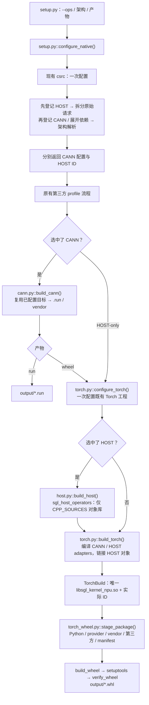

# 原生算子构建架构与文件调用关系

基线为合入 #923 的主线 `26ec66e`。所有仓内算子复用 `sgl_register_operator()`，以 `EXECUTION_UNIT AICORE/AICPU/HOST` 表示执行单元；用户只传 `--ops`，不增加构建类型参数。已有 AICORE/AICPU 算子的声明文件保持不变。CMake 自带的 `CMAKE_BUILD_TYPE=Release` 仍然只表示优化配置。

## 1. 从入口到产物



正常顺序为：根入口统一配置 → 第三方依赖 → 可选 CANN 构建/安装 → Torch 工程配置 → 可选 HOST 对象编译 → Torch 注册层编译与链接 → 暂存与打包。CANN 目标在第一次配置时建立，后续 `build_cann()` 复用；HOST-only 的根配置在 SDK/编译器初始化前返回。HOST 对象与 Torch 扩展复用原有 Torch CMake 工程及 `build/torch` 目录；该工程只配置一次。

`cann.py` 只拥有 CANN 构建结果；`host.py` 只负责编译 HOST 实现对象；`torch.py` 负责共享工程配置、Torch 注册层编译及最终链接；`torch_wheel.py` 负责消费已经构建的产物。统一选择在根 `setup.py`，没有独立选择模块或选择工程。两组算子仍复用一套 CMake 注册元数据。

## 2. 按调用流程逐文件说明

### 2.1 根 setup.py：统一选择与阶段编排

`arguments()` 解析原有架构、产物、并行度和第三方参数，`--ops` 可混选三个执行单元，不增加构建类型选项。

`configure_native()` 从原来的 `cann.py` 移到根入口：它检查配置缓存，配置现有 `csrc` 一次，并读取两个实际选择文件。返回值为 `(CANN 配置或 None, HOST ID 元组)`；HOST-only 不再创建一个携带 HOST 状态的 `CannBuild`。错误仍在第三方构建和旧输出清理前传播。`--plan` 保留仅预览第三方 JSON 的语义。

`main()` 执行原有第三方流程。有 CANN 配置才调用 `build_cann()`；`.run` 分支直接输出 CANN 安装包。wheel 分支先调用 `configure_torch()` 配置两个目标；HOST 集合非空时调用 `build_host()`，再调用 `build_torch()`。最终将 `TorchBuild` 和可选 CANN 结果交给 `stage_package()`，最后执行 `build_wheel()`。

### 2.2 build_tools/common.py 与 cann.py：公共工具和 CANN 构建

`common.py` 存放原来位于 `cann.py` 的公共命令执行、目录清理、缓存读取、架构查询及 ID 语法解析。它不导入任何后端，Host 构建器无需通过 CANN 模块取得这些工具；没有新增算子选择框架。

`CannBuild` 恢复为 CANN 专用结果，只有 CANN ID、架构、构建目录、安装包、vendor 和请求形式。删除 `host_operators`；`build_cann()` 不再读取 HOST 选择文件或传递 HOST ID。

`build_cann(configured, ...)` 必须接收已有的 `CannBuild` 配置结果；架构、目录和算子集合均从该结果取得。它检查缓存和实际选择后，直接执行设备检查、打包、安装与完整性验证；没有自行配置或 `configured=None` 的兼容分支。AICPU-only 安装的 `--force` 条件及所有构建失败传播保持原样。

### 2.3 csrc/CMakeLists.txt：在现有配置流程中选择

保留历史 `SGL_CANN_OPERATORS` 入口。额外的内部 `SGL_NATIVE_OPERATORS` 接收根 `setup.py` 的统一请求；`SGL_NATIVE_ARTIFACT` 用于检查 HOST 与 `.run` 的兼容性。这些不是新增用户构建类型选项。原工程只选择 CANN 算子，因此 `.run` 和 wheel 的算子范围一致，不需要将产物类型传给选择器。加入 HOST 后，wheel 的 `ALL` 可以包含 HOST，而当前 `.run` 只打包 CANN；`SGL_NATIVE_ARTIFACT` 将已有 `--artifact` 传入选择器，让其对 `ALL` 记录排除原因，并拒绝 `.run` 的显式 HOST 请求。

不新增 `SGL_NATIVE_SDK_ROOT`。根 Python 入口仅在复用 CANN 配置时检查已有的 `SGL_CANN_SDK_ROOT`，且在重新配置覆盖缓存之前检查；HOST-only 的选择不依赖 SDK。实际 Torch 编译环境由 `configure_torch()` 的 Python/Torch/SDK 签名检查。

声明发现分为两个阶段。先调用 `sgl_add_host_operator_domains()` 登记 HOST 元数据，通过注册表取得全部 HOST ID。根入口按这些 ID 拆分原始 `SGL_NATIVE_OPERATORS`，只把 CANN 请求写入 `SGL_CANN_OPERATORS`；HOST 请求保存在独立变量中。`ALL` 在 CANN 变量中仍表示全部 CANN 算子，统一选择器再根据原有规则选择 HOST。

局部变量统一使用 `cann_operators` / `host_operators`，先存放拆分后的请求，再由统一选择器覆盖为最终构建集合；`registered_host_operators` 单独表示已登记的 HOST 集合。CANN 依赖展开后，必须从 `SGL_CANN_OPERATORS` 读取已展开的输入，不能复用展开前的局部列表。原始请求仍保存在 `SGL_NATIVE_OPERATORS`。CANN/HOST 文本输出分别使用 `cann_selection_text` / `host_selection_text`。

随后调用 `sgl_add_cann_operator_domains()`。旧 cache-location 声明只会看到 CANN ID，照常把 assign/update 补齐；完成发现后，统一选择器合并已展开的 CANN 请求与独立 HOST 请求，验证 ID、架构和产物并导出实际集合。未知 ID 仍在 SDK 发现前失败，不按目录名或 ID 前缀猜测类型。

`SGL_NATIVE_OPERATORS` 始终保存原始用户请求；`SGL_CANN_OPERATORS` 在发现、依赖展开和最终缓存中都不包含 HOST。根入口不再把 HOST 写入 CANN 变量，也不再追加 `EVAL/DEFER` 恢复操作。旧声明自身的延后恢复保持原样，因此 CANN 缓存可以保留原始 CANN 请求，最终实际构建 ID 以 `selected-operators.txt` 为准。

例如原始请求 `cache_loc_assign;transfer_mamba_state`，进入旧声明的只有 `cache_loc_assign`；实际 CANN 输出为 assign/update 两个 ID，实际 HOST 输出为 transfer_mamba_state。重复配置依然从未变的原始请求重新拆分。

写出 `selected-operators.txt`、`selected-host-operators.txt`，并保留原有 AICPU ID 缓存。CANN 集合为空时立即返回，此时没有发现 SDK、启用 C++ 编译器或创建 CANN 打包目标。集合非空时继续原有 SDK 加载和 AICORE/AICPU 目标配置。

### 2.4 domains.cmake → 算子声明 → operators.cmake

`domains.cmake` 将 HOST 与 CANN 声明发现分为两阶段。当前 HOST 阶段登记 data_move，CANN 阶段保持原 sampler/attention/mem_cache/lora/examples 域。两阶段均校验新增声明的执行单元：HOST 阶段出现 CANN、或 CANN 阶段新增 HOST 时直接报错，避免新增模块破坏提前拆分的前提。新增 HOST 声明需要登记到 HOST 阶段。原 `sgl_add_operator_domains()` 包装入口仍供 Torch 等已经持有两组 ID 的调用方一次发现全部声明。发现一个目录只登记元数据，不会把所有源码加入目标。

`operators.cmake` 仍统一处理注册、变体、字段查询和架构解析。扩展 `EXECUTION_UNIT HOST` 与 `CPP_SOURCES`，HOST 要求实现源码和 Torch adapter，并拒绝设备专用字段。既有 AICORE/AICPU 字段语义不变。

索引明确分为 `SGL_NATIVE_OPERATOR_IDS`（全部原生）、`SGL_CANN_OPERATOR_IDS`（AICORE/AICPU）和 `SGL_HOST_OPERATOR_IDS`（HOST）。原 `SGL_OPERATOR_IDS` 更名为 `SGL_CANN_OPERATOR_IDS`，原 `sgl_select_operators()` 更名为 `sgl_select_cann_operators()`；内部调用同步更新，算子声明无需修改。`sgl_get_registered_operators(out)` 的默认查询和 `sgl_select_cann_operators(... ALL)` 都只面向 CANN。按 `EXECUTION_UNIT` 查询可取得 HOST/AICORE/AICPU 子集。`sgl_select_native_operators()` 直接放在此文件内，按 ID 查声明、检查架构/产物并分流；CANN 子集复用原选择器，HOST 子集复用原 resolver。未知、重复、显式不支持架构等请求直接失败。

### 2.5 cann_ops.cmake 与 cmake/aicpu：保持原设备工程

这两个构建器及 AICPU 的 `merge_json.py` 均保持主线内容。AICORE 仍生成接口、Host 库、Tiling 和 Kernel；AICPU 仍在独立目录作用域中使用 HCC 编译设备库，并合并注册 JSON。

HOST 实现不经过 CANN codegen、AI Core 工具链或 HCC。`build_cann()` 的原检查/打包目标仍只覆盖 CANN 设备与 Host 产物。

### 2.6 torch.py → Torch CMake → host.py / build_torch：配置一次，分目标编译

`torch.py::configure_torch(arch_version, operators, *, cann=None, ...)` 负责共享配置。`operators` 只包含 HOST ID，可选 `cann` 提供实际 CANN ID 和已安装 vendor。这里校验架构、请求形式、Torch/Python/SDK 环境和构建缓存，然后配置现有 `csrc/aclnn_torch_adapter` 工程一次，不编译。返回 `TorchBuild` 配置，`library=None`；只有成功链接后才填入动态库路径。

两份 txt 沿用 CMake 向 Python 回传最终集合的方式。Python 从 HOST txt 读取 ID，再通过 `-DSGL_HOST_OPERATORS=...` 传给共享 Torch 工程；CANN adapters 通过 `SGL_CANN_OPERATORS` 传入。根选择入口不额外写入未使用的 HOST 缓存。

`cpp_ops.cmake::sgl_collect_cpp_sources()` 分别返回实现源码、Torch adapters、选择宏三份列表，各自去重。`CPP_SOURCES` 只进入内部 `sgl_host_operators OBJECT` 目标，HOST/CANN 的 `TORCH_ADAPTER` 进入原有 `sgl_kernel_npu SHARED` 目标。后者通过 `target_link_libraries(... sgl_host_operators)` 纳入 HOST 对象，并建立构建依赖，不新增动态库，也不改变原 `.so` 的加载方式。

`host.py::build_host(arch_version, operators, *, directory, ...)` 只接受 HOST ID 和已配置目录。核对缓存后执行 `cmake --build build/torch --target sgl_host_operators`，返回 `HostBuild(directory, operators, arch_version)`。它不接收 CANN ID/vendor，不配置工程，不编译 adapter，不执行链接。HOST 为空时根入口跳过该阶段。

`torch.py::build_torch(configured, *, host=None, ...)` 检查 HOST 对象与共享配置的目录、架构、ID 一致，然后执行 `cmake --build build/torch --target sgl_kernel_npu`。该阶段编译所选 CANN/HOST adapters，并链接已经编译的 HOST 对象。CMake 仍保留对象依赖，已有对象未变化时不会重复编译。无 HOST 时不需要对象结果，直接构建 CANN adapters。成功后返回带 `libsgl_kernel_npu.so` 的 `TorchBuild`。

两个目标都使用匹配的 Torch ABI 选项、C++17、可见性设置和所选 HOST 宏；HOST 对象启用 PIC。现有 HOST 实现使用 ATen、torch_npu 和 ACL，因此拆分后仍需要这些头文件。仓内 CANN vendor 的 include 和 nnopbase 链接依赖只加到最终 Torch 扩展，HOST 对象目标不消费它们。

每个选中 HOST ID 自动生成 `SGL_CPP_<UPPERCASE_ID>=1`，同时用于实现和注册层的共享文件裁剪。独立实现和 adapter 可以不使用宏，直接按源码选择。宏生成目前没有关闭选项，现有 data_move 仍依赖 guard。

### 2.7 torch_wheel.py：只暂存与打包

`stage_package(torch, *, cann=None, dependencies=...)` 消费已构建的 `TorchBuild` 和可选 `CannBuild`。它先检查最终 Torch 库存在，并校验 CANN ID、架构、请求形式及 vendor 路径与 Torch 编译时一致，防止把另一份 CANN 载荷混入 wheel。

随后通过 `stage_runtime()` 暂存 Python、provider、配置与可选仓内 vendor，通过原有第三方逻辑暂存外部 vendor、绑定和许可证。schema 2 清单直接记录 Torch 编译结果中的实际 ID。最后复制已构建的 `.so`；此函数不执行配置或编译命令。

`build_wheel()` 继续通过 `SGL_REFACTOR_STAGED_PACKAGE` 进入 setuptools hook，只打包暂存结果并验证标签、内容和二进制元数据。

包内 `__init__.py` 按清单决定是否必须存在仓内 vendor，继续检查第三方 vendor，设置 `ASCEND_CUSTOM_OPP_PATH` 并加载同一个 Host 扩展。已有运行时接口不变。

## 3. 选择和环境规则

| 请求 | wheel | `.run` |
| --- | --- | --- |
| 显式 AICORE/AICPU ID | 所选 CANN vendor 与 adapters | 所选 CANN 包 |
| 显式 HOST ID | 所选 Host 实现与 adapter | 失败，不静默丢弃 |
| 混合执行单元 ID | 同一 wheel，按需带 CANN vendor | 含 HOST 则失败 |
| `all` | 架构支持的全部仓内原生算子 | 全部支持的 CANN 算子，逐项记录 HOST 排除原因 |
| 未知/重复/显式不支持架构 ID | 在 SDK 目标配置与第三方构建前失败 | 同左 |

HOST-only 的**选择配置**不依赖 SDK/编译器，但完成实际 Torch 扩展构建仍需要 Linux、ACL SDK、匹配的 Torch/torch_npu 和 Host 编译器。`--ops` 不裁剪 Python 文件，不选择第三方 profile；第三方仍使用 `--third-party` / `--without-third-party`。

## 4. 产物与缓存

```text
build/
├── third_party/                 # 独立 profile 缓存
├── cann/                        # 所有原生请求复用的配置目录
│   ├── CMakeCache.txt
│   ├── configure.log
│   ├── selected-operators.txt   # 实际 CANN ID；HOST-only 时为空
│   ├── selected-host-operators.txt
│   ├── autogen/                 # 以下均仅按实际 CANN 需要生成
│   ├── aicpu/
│   ├── package-stage/*.run
│   └── installed/vendors/sgl_kernel_npu/
├── torch/
│   ├── CMakeFiles/sgl_host_operators.dir/ # 可选 HOST 实现对象，非动态库
│   ├── lib/libsgl_kernel_npu.so
│   └── package/sgl_kernel_npu/
│       ├── lib/libsgl_kernel_npu.so
│       ├── _build_manifest.json
│       ├── _cann/vendors/        # 可选仓内/第三方 vendor
│       └── _third_party/         # 外部绑定和许可证
└── wheel/                       # setuptools 暂存及验证日志
output/                          # 最终 .run / .whl
```

没有临时选择目录、选择 JSON 或生产用的独立 HOST 源码清单。切换架构、ID、产物，或实际编译依赖的 SDK 等环境时要求 `--make-clean`；HOST-only 选择本身允许 SDK 环境变化；第三方缓存按原规则保留。

## 5. 验证边界

主线没有新构建入口 `build_tools` 的专用测试，因此本次不向仓库新增 `tests/build_tools`。已有功能测试保持不变。开发期通过仓库外临时检查验证统一选择、两种架构、既有 CANN 字段解析、对象/注册目标归属、共享宏、错误传播、SDK 缓存、暂存和 wheel 完整性；依赖桩用于目标生成，不替代真实 CANN/HCC/Torch 编译。

无需 SDK 的选择检查：

```bash
cmake -S csrc -B /tmp/sgl-host-selection-2201 \
  -DSGL_ARCH_VERSION=2201 \
  -DSGL_NATIVE_OPERATORS=transfer_mamba_state \
  -DSGL_NATIVE_ARTIFACT=wheel
cat /tmp/sgl-host-selection-2201/selected-operators.txt
cat /tmp/sgl-host-selection-2201/selected-host-operators.txt
```

前者为空、后者仅有 `transfer_mamba_state`。更换目录并将架构改为 `3510` 可验证另一架构。CANN-only、混合和 `.run` 的真实构建需在初始化 CANN、Torch/torch_npu 的 Linux 环境执行；已有功能测试需 NPU。详见 Python 包 README 中的编译示例。
