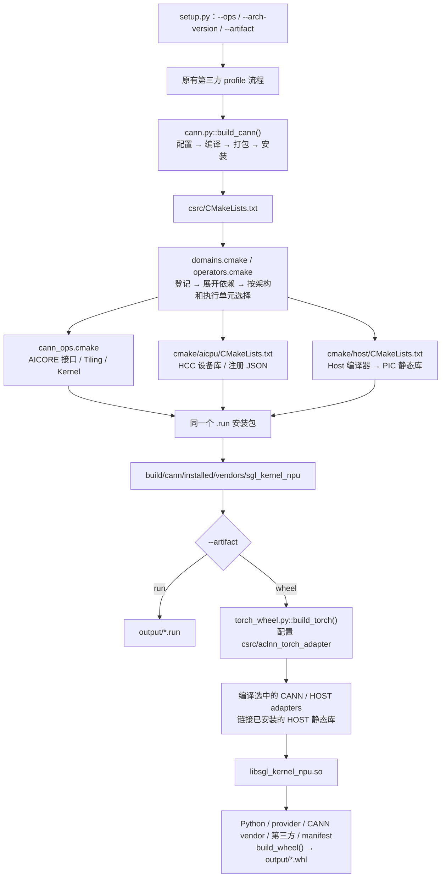

# 原生算子构建架构与文件调用关系

所有仓内原生算子复用 `sgl_register_operator()`，通过 `EXECUTION_UNIT AICORE/AICPU/HOST` 指定执行单元。用户只通过 `--ops` 选择算子，不增加构建类型参数。已有 AICORE/AICPU 声明、`cann_ops.cmake` 和 `cmake/aicpu` 保持不变。

## 从入口到产物



`.run` 是三类产物的安装包，不把不同执行单元链接成一个二进制。HOST 实现先生成 `libsgl_host_operators.a`，安装后由 Torch 构建链接进已有的 `libsgl_kernel_npu.so`，不新增运行时动态库。Torch 注册代码直接参与最终 `.so` 的编译，避免仅含注册初始化的对象被静态链接丢弃。

## 按编译流程逐文件说明

### 1. setup.py

恢复原有的 `build_cann(arch, operators) → build_torch(result, arch) → build_wheel(package)` 流程；选择 `.run` 时不执行 Torch adapter 和 wheel 构建。第三方 profile、`--plan`、清理和最终输出流程沿用主线。

删除 `configure_native()` 和 Python 层的 HOST 单独调度；不再需要 `configure_torch()`、`build_host()`、`TorchBuild`，相应的 `build_tools/host.py` 和 `torch.py` 删除。公共辅助函数回到主线原有的 `cann.py`，删除本轮不再需要的 `common.py`。HOST 的构建依赖由 CMake 管理。

### 2. build_tools/cann.py

`build_cann()` 恢复为完整的配置、编译、打包、安装入口。将用户请求通过 `SGL_NATIVE_OPERATORS` 传给现有 `csrc` 工程；CMake 负责分类，Python 不维护算子名单。`Python3_EXECUTABLE=sys.executable` 将配置固定到执行 `setup.py` 的 Python，使 HOST 使用同一环境中的 Torch/torch_npu；不依赖系统 PATH 恰好指向该解释器。

配置后读取 `selected-operators.txt` 和 `selected-host-operators.txt`。`CannBuild.operators` 仍只记录 CANN ID，新增 `host_operators` 传递 HOST ID，供后续 Torch adapter 选择和清单记录使用。txt 是配置阶段回传实际集合的原有方式，HOST 静态库本身由 CMake target 的源码列表编译，不由 Python 二次编排。

继续依次执行 `sgl_cann_kernel_check`、`package` 和安装命令。保留原有聚合目标名称；它现在也依赖选中的 HOST 静态库，确保打包前产物已生成。

没有 AICORE 的包不含 opmaster，安装时沿用 AICPU-only 的 `--force` 处理，覆盖 HOST-only 和 AICPU/HOST 混合包。安装后仍检查实际选中产物；HOST 静态库复用原有文件对比循环，不能用 `--force` 掩盖漏装或文件不一致。真实 SDK 的 HOST-only 安装仍需在 Linux 环境验证。

### 3. csrc/CMakeLists.txt / domains.cmake / operators.cmake

先登记 HOST，再从 `SGL_NATIVE_OPERATORS` 拆出 CANN 请求，随后登记 CANN 并执行原有依赖展开。`SGL_CANN_OPERATORS` 始终不含 HOST；例如只请求 `cache_loc_assign` 时，旧声明仍会补齐 `cache_loc_update`，无需修改声明。

统一选择器按注册 ID 和架构得到 CANN/HOST 两组实际集合，再将 CANN 分成 AICORE/AICPU。变量统一使用 `cann_operators`、`host_operators`、`aicore_operators`、`aicpu_operators`。

删除 `SGL_NATIVE_ARTIFACT` 和 HOST 的 `.run` 排除规则：现在两种产物使用相同的原生算子集合，`all` 包含当前架构支持的三类算子。删除没有 CANN 时的提前返回；即使只选 HOST，也继续创建同一个安装包，并按需 `add_subdirectory(cmake/host host)`。只有选中 AICPU 才进入 HCC 子目录，只有选中 HOST 才加载 Torch 开发依赖。

注册、架构变体、源码选择和已有 CANN 依赖规则保持原义；不新增 before/after 声明阶段校验。

### 4. cmake/host/CMakeLists.txt / host_ops.cmake / torch.cmake

新的 HOST 子目录与 `cmake/aicpu` 并列。`sgl_collect_host_sources()` 从同一注册表提取所选 `CPP_SOURCES`、adapters 和选择宏；子目录只编译实现源码，生成启用 PIC 的 `sgl_host_operators STATIC`。

未显式指定编译配置时，仅为 HOST 静态库加入 `-O3` 和 `NDEBUG`，对齐旧构建默认的 Release 优化。显式指定 Debug、Release 等配置时沿用工具链参数；多配置生成器使用所选配置。不再在 HOST 子目录设置无效的局部 `CMAKE_BUILD_TYPE`，也不改变父工程的 CANN 编译配置。

通过 `npu_op_package_add(... FILES ... PACKAGE_PATH op_impl/host/lib)` 把静态库加入已有 `.run`，安装位置为 `vendors/sgl_kernel_npu/op_impl/host/lib/libsgl_host_operators.a`。执行 `.run` 只安装文件；HOST 包不包含 Torch 注册层，后续 `build_torch()` 编译 adapters 并链接安装后的静态库，才形成可加载的扩展。不伪造 `CANN_OP_TYPE`，不调用 HOST 不需要的 OpDef/codegen、Tiling、设备编译器。

`torch.cmake` 仅提取原 Torch CMake 中已有的 Python、Torch/torch_npu 头文件和 ABI 配置查询，供 HOST 实现与 adapters 复用。当前 HOST 源码使用 ATen/torch_npu/ACL，因此包含 HOST 的 `.run` 也需要匹配的 Torch/torch_npu 开发环境；纯 CANN `.run` 保持不依赖 Torch。

选择宏仍是 `SGL_CPP_<ID>=1`，用于已有共享源码的条件编译；独立源码可不引用宏。已有宏和算子实现不在本次修改范围内。

### 5. build_tools/torch_wheel.py / aclnn_torch_adapter/CMakeLists.txt

`build_torch()` 恢复原有的一次调用：准备包目录、配置 Torch 工程、编译、检查并复制动态库。向该工程传入实际 CANN/HOST ID 和同一次 `.run` 的安装目录。

Torch CMake 只编译选中的 `TORCH_ADAPTER`，不再创建 HOST 对象目标。存在 HOST 时，从已安装 vendor 查找静态库并链接；不存在 HOST 时不查找。CANN adapters 继续使用已安装 ACLNN 头文件及原 SDK 依赖。

wheel 清单沿用 `schema_version: 1`，`operators` 记录 CANN/HOST 并集，并通过 `operators_by_type` 记录两组实际 ID。wheel 标签统一计算实际算子集合的哈希，不按 schema 版本分支。HOST 静态库只用于最终链接，不复制进 wheel；HOST-only 的 wheel 不需要仓内 CANN vendor。既有运行时加载路径、第三方依赖和 wheel 校验不变。

## 构建目录与验证边界

```text
build/cann/
├── selected-operators.txt
├── selected-host-operators.txt
├── autogen/                         # 按 CANN 实际需要生成
├── aicpu/                           # 仅选中 AICPU
├── host/libsgl_host_operators.a      # 仅选中 HOST
├── package-stage/*.run
└── installed/vendors/sgl_kernel_npu/
    ├── op_api/ ...                  # CANN 产物
    └── op_impl/host/lib/libsgl_host_operators.a
build/torch/
├── lib/libsgl_kernel_npu.so
└── package/sgl_kernel_npu/
build/wheel/
output/
```

更换架构、算子集合、SDK 或 Torch/Python 环境时仍使用 `--make-clean`。两种产物现在共享同一原生配置，不再因为从 `.run` 切换到 wheel 而改变选择集合。

开发验证放在仓库外，不新增 `tests/build_tools` 或 diagrams 文件。CPU 检查覆盖注册与选择、两种架构的实际 CMake 目标生成、静态库编译/安装/链接、Python 调度及错误传播；SDK/Torch 依赖桩不替代真实 Linux/CANN/HCC/NPU 构建。构建和功能测试命令见 Python 包 README。
