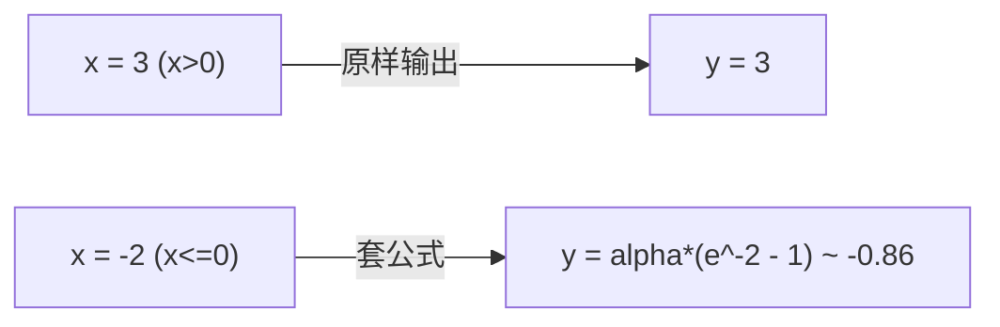
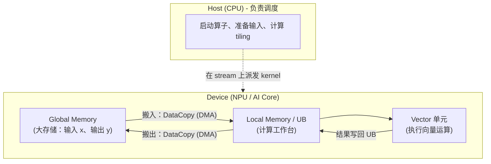
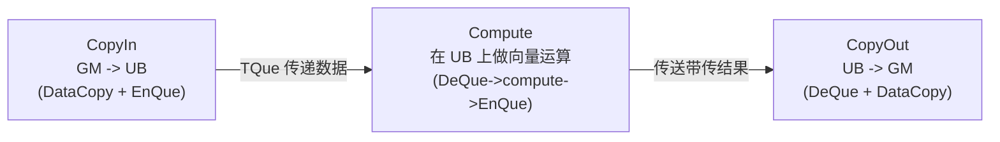
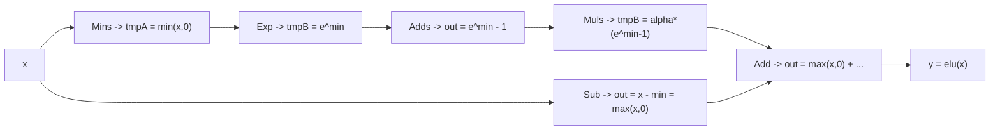
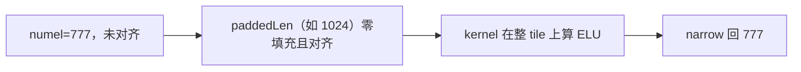

# 从零写一个 Ascend C 算子：ELU 样例

> 这是一篇**手把手**教程：即使你之前从未写过 Ascend C 算子，也能跟着它把一个真实算子写出来，并让 SGLang / PyTorch 一行调用它。例子选用 **ELU** 激活函数——纯粹的逐元素算子，足够简单，让你把注意力放在 Ascend C 算子开发的**方法论**上，而不是被复杂算法淹没。
>
> 完整、可编译的配套代码见 `csrc/activation/elu/`，测试见 `tests/python/operators/activation/test_elu.py`，API 文档见 `docs/api/{zh,en}/operators/activation/elu.md`。边看代码边读本文效果最好。

---

## 1. 先建立直觉：这个样例到底算什么？

神经网络的每一层都在调用各种"对一批数据施加固定计算"的函数，这些函数统称为**算子**（OP）。

ELU 属于**激活**算子族，数学上逐元素：

$$
\mathrm{elu}(x) =
\begin{cases}
x, & x > 0 \\[4pt]
\alpha \cdot (e^{x} - 1), & x \le 0
\end{cases}
\qquad\qquad(\text{默认 } \alpha = 1.0)
$$

一句话：**对张量里的每一个数都做这个计算。**



正因为简单——没有跨元素依赖、没有查表、没有复杂边界——ELU 才是入门算子的最佳选择。

最终对外的调用形态：

```python
from sgl_kernel_npu.operators.activation import elu

y = elu(x, alpha=1.0)            # 默认 auto，走 Ascend C
y = elu(x, alpha=1.0, impl="torch_native")   # 显式选参考实现
```

---

## 2. 背景：在 Ascend NPU 上，代码究竟跑在哪里？

写算子前先记住一张"硬件地图"，只需三条前提：

1. **CPU 与 NPU 是两台机器。** 负责调度、判定、下发的叫 **Host（CPU）**，负责密集计算的叫 **Device（NPU）**。在 `sgl-kernel-npu` 里，"启动 / 搬运 / 分块"的代码跑在 Host 上（**host code**），"对每批数据计算"的代码跑在 Device 上（**kernel code**）。

2. **计算发生在 AI Core 里。** NPU 有很多 AI Core 可并行；每个核内有若干单元，这里只关心两个：
   - **Vector 单元**：一次对一整行数据做同一种向量运算。ELU 是纯向量算子，用它。
   - **Scalar 单元**：负责地址运算、循环与控制流，相当于核内的"小 CPU"。
   > 还有做矩阵乘的 **Cube 单元**，ELU 用不到，可以先忽略。

3. **NPU 有两级存储。** 计算单元不能直接对"远处"的大内存做运算：
   - **Global Memory（GM）**：大而慢，算子的输入输出都在这里；
   - **Local Memory（UB，片上）**：小而快，是计算单元真正操作的"工作台"。
   数据必须在两级存储之间来回搬运。



> 一句话：**算子 = 把数据从大存储搬到工作台 → 在工作台上算 → 把结果搬回大存储。**

---

## 3. 一个 ELU 算子的整体拼装图

重构后，一个 Ascend C 算子由"**csrc 原生实现** + **Python operator 层** + **测试** + **文档**"四部分组成：

```text
csrc/activation/                        # 算子域（domain）
├── CMakeLists.txt                      # 域入口：sgl_discover_operators()
└── elu/                                # 算子目录（ID = elu）
    ├── CMakeLists.txt                  # sgl_register_operator(...) 声明
    ├── op_host/elu.cpp                 # [Host] 校验、tiling、填充、启动 kernel
    └── op_kernel/kernel_elu.cpp        # [Device] AI Core 上真正计算 ELU

python/sgl_kernel_npu/sgl_kernel_npu/
├── implementation/torch_native/activation/elu.py   # 独立参考实现
└── operators/activation/elu.py                     # 公开 API + 注册与派发

tests/python/operators/activation/test_elu.py       # 精度 / 性能测试
docs/api/{zh,en}/operators/activation/elu.md        # 双语 API 文档
docs/api/{zh,en}/API_list.md                        # 索引
```

> 注册入口：当前 main 上 `torch.ops.npu.elu` 由共享文件 `csrc/pytorch_extensions.cpp`
> 注册（`m.def` + `m.impl`），源文件则由 `csrc/CMakeLists.txt` 的两个列表收录。
> CANN 构建入口（#880）合入后，注册会搬到算子自己的 `torch_adapter.cpp`，届时
> `csrc/activation/elu/CMakeLists.txt` 会补上 `TORCH_ADAPTER torch_adapter.cpp` 一行。

分工再说一遍：

- `op_kernel/*.cpp` **在 NPU 上算**；
- `op_host/*.cpp` **在 CPU 上调度**（校验、tiling、填充、启动 kernel），`torch.ops.npu.elu` 的注册目前写在 `csrc/pytorch_extensions.cpp`；
- `python/sgl_kernel_npu/sgl_kernel_npu/operators/activation/elu.py` 是**唯一公开入口**，`impl` 选择具体实现（`auto` 默认指向 Ascend C，无隐式回退）；
- `python/sgl_kernel_npu/sgl_kernel_npu/implementation/torch_native/activation/elu.py` 是**独立的参考实现**，只用于精度对比，不能调用被测 kernel。

推荐的"自底向上"写作顺序：
**先写 kernel（怎么算）→ 再写 host（怎么切、怎么启动）→ 然后注册 `torch.ops.npu.*` → 最后 operator 层暴露 API、补测试和文档。**

---

## 4. 第 1 步：写 kernel —— AI Core 上的 ELU 计算

### 4.1 kernel 的固定骨架

绝大多数简单 Ascend 算子都是同一个模板：**一个类 + 一个入口函数**。

- **类**（这里是 `KernelElu`）承载算子逻辑，拆成两个成员：
  - `Init(...)`：初始化——算出本核负责哪段数据，并在 UB 上申请内存；
  - `Process()`：主循环——搬入、计算、搬出，反复进行。
- **入口函数**（`elu_fp16` / `elu_fp32`）是 NPU/framework "调用你的算子"的那扇门：创建类对象并调用 `Init` 与 `Process`。

```cpp
// 每种数据类型一个入口。编译器会据此外部生成 host 可用的 aclrtlaunch_*.h。
extern "C" __global__ __aicore__ void elu_fp16(
    GM_ADDR x,             // 输入 x 在 Global Memory 的地址
    GM_ADDR y,             // 输出 y 在 Global Memory 的地址
    uint32_t totalLength,  // 待处理元素总数
    uint32_t tileLength,   // 每"块"搬运多少元素
    float alpha)           // ELU 公式里的系数 alpha
{
    KernelElu<half> op;
    op.Init(x, y, totalLength, tileLength, alpha);
    op.Process();
}
```

限定符速查：`__global__` 表示可从外部启动；`__aicore__` 表示运行在 AI Core；`GM_ADDR` 等价于 `__gm__ uint8_t* __restrict__`。

### 4.2 三类内存对象：GlobalTensor / LocalTensor / Queue

打开 `kernel_elu.cpp`，你主要会看到三类对象：

| 对象 | 所在内存 | 通俗解释 | 声明示例 |
|---|---|---|---|
| `GlobalTensor<T>` | Global Memory | 指向"大存储"里的数据，可读可写 | `AscendC::GlobalTensor<T> xGm;` |
| `LocalTensor<T>` | Local Memory (UB) | 工作台上的一块，计算只能在这里发生 | `AscendC::LocalTensor<T> xLocal;` |
| `TQue<position, N>` | Local Memory | "传送带/队列"，在 CopyIn/Compute/CopyOut 之间传递数据块 | `AscendC::TQue<...VECIN, 2> inQueueX;` |
| `TBuf<position>` | Local Memory | 单个任务私有的临时内存，不跨任务传递 | `AscendC::TBuf<...VECCALC> tmpBufA;` |

### 4.3 简单 kernel 的"三部曲"：CopyIn → Compute → CopyOut

Ascend 把"处理数据"组织成**流水线**：一个工位干完，把半成品放上传送带交给下一个工位。



因为数据量大、"UB 一次装不下"，所以每次只搬一小块（`tileLength` 个元素），搬到一块算一块，循环 `tileCount` 次干完本核区间。

```cpp
__aicore__ inline void Process()
{
    for (uint32_t i = 0; i < this->tileCount; i++) {
        CopyIn(i);    // 第 i 块：GM -> UB，入队 inQueueX
        Compute();    // 出队 -> 算 ELU -> 结果入队 outQueueY
        CopyOut(i);   // 出队结果，搬回 GM
    }
}
```

### 4.4 两个搬运小函数（关键片段）

**CopyIn：把输入搬进来。** `AllocTensor` 从队列申请一块工作台，`DataCopy` 搬入，`EnQue` 告诉 Compute "数据就绪"：

```cpp
__aicore__ inline void CopyIn(uint32_t progress)
{
    AscendC::LocalTensor<T> xLocal = inQueueX.AllocTensor<T>();
    AscendC::DataCopy(xLocal, xGm[progress * this->tileLength], this->tileLength);
    inQueueX.EnQue(xLocal);
}
```

**CopyOut：把结果搬出去。** `DeQue` 取出算好的结果并搬回 GM：

```cpp
__aicore__ inline void CopyOut(uint32_t progress)
{
    AscendC::LocalTensor<T> outLocal = outQueueY.DeQue<T>();
    AscendC::DataCopy(yGm[progress * this->tileLength], outLocal, this->tileLength);
    outQueueY.FreeTensor(outLocal);
}
```

### 4.5 重头戏：Compute 如何把 ELU "翻译"成 Ascend 指令

难点在于：ELU 是**分段函数**，而 Ascend Vector 单元**对整块数据施加同一种运算，不逐元素分支**。

**技巧：把分段函数改写成一个统一表达式。** 利用恒等式 $\max(x,0)=x-\min(x,0)$：

$$
\mathrm{elu}(x)=\underbrace{\alpha\cdot\big(e^{\min(x,0)}-1\big)}_{\text{负责 } x \le 0}+
\underbrace{\big(x-\min(x,0)\big)}_{=\;\max(x,0),\ \text{负责 } x > 0}
$$

Ascend 提供现成向量指令，一条处理一整行。我们把公式拆成六条指令，用两个临时张量 `tmpA`、`tmpB` 接力：

```cpp
// outLocal 为最终输出；tmpA/tmpB 为中间结果；n = tileLength
AscendC::Mins (tmpA,     xLocal,   static_cast<T>(0),  n);  // tmpA = min(x,0)
AscendC::Exp  (tmpB,     tmpA,                     n);  // tmpB = e^{min(x,0)}
AscendC::Adds (outLocal, tmpB,     static_cast<T>(-1), n);  // out = e^{min(x,0)} - 1
AscendC::Muls (tmpB,     outLocal, alpha,             n);  // tmpB = alpha*(e^{min(x,0)}-1)
AscendC::Sub  (outLocal, xLocal,   tmpA,              n);  // out  = x - min(x,0) = max(x,0)
AscendC::Add  (outLocal, outLocal, tmpB,              n);  // out  = max(x,0) + alpha*(e^min-1)
// 不要忘记移交与回收：结果入队给 CopyOut，输入 buffer 归还给队列
outQueueY.EnQue<T>(outLocal);
inQueueX.FreeTensor(xLocal);
```



**为什么先 `min(x,0)` 再 `exp`？** 对 $x>0$ 我们不需要这条支路；对 $x\le 0$，`exp(x)` 落在 $(0,1]$，永远不会溢出，fp16 也安全。

---

## 5. 第 2 步：Init —— 决定"每个核领哪份工"

`Process()` 只负责"搬/算/送"，**搬哪一段、搬多大**由 `Init()` 决定。`Init` 根据并行核数（`GetBlockNum`）与自己的编号（`GetBlockIdx`）算出**本核负责的数据区间**。

类比：一条长街由 N 个清洁工分段打扫。`GetBlockNum` 是总人数，`GetBlockIdx` 是你的工号（0,1,2,…）。

```cpp
__aicore__ inline void Init(GM_ADDR x, GM_ADDR y, uint32_t totalLength, uint32_t tileLength, float alpha)
{
    this->tileLength = tileLength;
    this->alpha = static_cast<T>(alpha);

    uint32_t blockLength = totalLength / AscendC::GetBlockNum();  // 每核元素数
    this->tileCount = blockLength / tileLength;                   // 本核搬几轮

    uint32_t blockOffset = blockLength * AscendC::GetBlockIdx();  // 我这段的起点
    xGm.SetGlobalBuffer((__gm__ T*)x + blockOffset, blockLength);
    yGm.SetGlobalBuffer((__gm__ T*)y + blockOffset, blockLength);

    pipe.InitBuffer(inQueueX, BUFFER_NUM, tileLength * sizeof(T));
    pipe.InitBuffer(outQueueY, BUFFER_NUM, tileLength * sizeof(T));
    pipe.InitBuffer(tmpBufA, tileLength * sizeof(T));
    pipe.InitBuffer(tmpBufB, tileLength * sizeof(T));
}
```

`pipe.InitBuffer(...)` 里：*输入队列* `inQueueX` 与*输出队列* `outQueueY` 传了 `BUFFER_NUM`(=2) 块，两个临时工作台只给 1 块。这里藏着两个 Ascend 设计要点。

**（1）为什么队列给两块？—— 双缓冲（Double Buffering）。** 搬运（DMA）与向量计算（Vector）是硬件上**两条独立的流水**，天然可以重叠。队列有 2 块后，同一时刻一件事在算、另一件事在搬：


- **单缓冲的毛病**：只有一块内存时，算的时候不搬、搬的时候不算，Vector 单元大量时间在等搬运。
- **双缓冲的好处**：一边算一边搬，把搬运时间藏进计算时间，吞吐明显提升。给更多块（3、4…）还能进一步填满搬运流水线，但更占内存。

**（2）为什么两个临时工作台只给一块？—— 它们不往下游传递。** `inQueueX`/`outQueueY` 是"传送带"，同一块数据流经 CopyIn→Compute→CopyOut，需要队列同步和两块交替；`tmpA`/`tmpB` 只是单次 Compute 内部的草稿纸，用完即弃，**不存在任务间交接**，一块足够。

**（3）双缓冲不免费。** 它更占 UB：队列占得多了，`tmpA`/`tmpB` 或每块元素数就得缩水，反而可能增加搬运轮次。所以缓冲块数是**权衡**——看输入大小、搬运与计算谁更耗时、UB 还剩多少，而不是无脑加大 `BUFFER_NUM`。本样例在"搬运可能是瓶颈"的输入/输出队列上用双缓冲，内部草稿保持单份，是常见且稳妥的默认。

---

## 6. 第 3 步：Host 侧 Tiling —— 怎么切这个巨大的张量

kernel 一直在用 `totalLength`、`tileLength`，**这两个数是谁算的？** 答案是 Host 侧代码 `csrc/activation/elu/op_host/elu.cpp`。

Ascend 把这套"切块"称为 **Tiling**：把一次装不进 UB 的大张量切成一块块能装下的 tile，并决定怎么分配。切分时必须满足三条规则：

1. **512 元素对齐**：`tileLength` 取 512 的整数倍（fp16 为 1 KB、fp32 为 2 KB），它是硬件 32 字节最小对齐要求的超集；
2. **搬运效率**：每次尽量多搬、把 UB 用满，减少往返次数（搬运通常是性能瓶颈）；
3. **多核均衡**：任务均匀摊到各核，别让某些核闲置。

Host 侧 Tiling 归结为选两个数：`tileLength`（每块元素数）与 `blockDim`（使用核数）：

```cpp
uint32_t tileLength = ComputeTileLength(x.element_size());  // 对齐且装得下

int64_t numTiles = (numel + tileLength - 1) / tileLength;   // 需要的 tile 数（向上取整）
// 至少启动 1 个核：numTiles 可能小于核数，但不能为 0
int64_t blockDim = std::min(coreNum, std::max<int64_t>(1, numTiles));
```

`ComputeTileLength` 的思路：先为系统预留一部分 UB，再按"一块在飞的缓冲需要多少字节"算出能放几个 512 元素的对齐 slab，最后加上上限，避免小输入申请过大的 slab：

```cpp
// BUFFER_NUM=2 时同时在飞的缓冲 = 2 输入 + 2 输出 + 2 临时 = 6
uint64_t bytesPerUnit = VEC_ALIGN_ELEMS * elemSize * BUFFERS_PER_TILE;
uint64_t alignUnits  = (bytesPerUnit > 0) ? (usableUb / bytesPerUnit) : 0;
if (alignUnits == 0) {
    alignUnits = 1;   // 至少一块，保证 tileLength 不为 0
}
uint64_t tileElems = std::min<uint64_t>(alignUnits * VEC_ALIGN_ELEMS, TILE_ELEMS_CAP);
```

> 记住这个分工：**Host 决定切多大（并把"尺子"交给 kernel），kernel 只管照着搬和算。**

---

## 7. 第 4 步：处理"不整齐"的输入 —— 对齐与填充

前面假设"总数刚好整除、处处整齐"。可现实中张量有 777 个元素怎么办？Ascend 的搬运要求宽对齐（代码里按 512 元素对齐），777 既不整除也不对齐。

本样例走"先把张量打扮整齐、算完再卸妆"的路子：

- **填充（padding）**：若 `numel` 不是 `blockDim × tileLength` 的整数倍，补零使 `paddedLen` 让每核正好分到整数个 tile；
- **兜底**：即使不足一个 tile，也补成一个 tile，保证每核都有活干且对齐；
- **卸妆**：NPU 返回的是填充后的长数组，Host 用 `.narrow(0, 0, numel)` 裁掉尾巴，再 `.view(x.sizes())` 恢复原形状。

> 设计细节：kernel 始终把输入当一维 `[numel]` 处理。所以填充前 Host 先用 `x.reshape({numel})` 展平（输入要求连续，因此是零拷贝），再拷进一维零填充缓冲，既避免把多维张量拷进一维视图时的广播错误，也让"元素数不变"的恢复步骤变得平凡。

好处：**kernel 里永远不需要写"最后一块怎么处理"这种最容易出错的尾处理分支**。代价：非对齐输入多一次填充拷贝；LLM 的激活张量通常已对齐，此时完全不做填充，走零开销快路径。

```cpp
int64_t paddedLen = ((numel + perBlockElems - 1) / perBlockElems) * perBlockElems;
bool needsPadding = (paddedLen != numel);
```



---

## 8. 第 5 步：把 kernel 交给 NPU —— Host 启动函数

有了 kernel（怎么算）和 tiling（怎么切），还需要一个 **Host 侧 C++ 函数**：接收 PyTorch tensor `x`，校验参数 → 展平 → 计算 tiling → 启动 kernel → 返回结果。

```cpp
HOST_API at::Tensor elu(const at::Tensor &x, double alpha)
{
    // 1) 校验：至少一维 / 连续 / 仅 fp16、fp32 / alpha 有限
    TORCH_CHECK(x.dim() >= 1, "...");
    TORCH_CHECK(x.is_contiguous(), "...");

    // 2) tiling（第 6 节）-> tileLength、blockDim、paddedLen；
    //    需要填充时把 x 拷进零填充的 xWork

    // 3) 启动 kernel —— 核心就一个宏（下面细说）
    EXEC_KERNEL_CMD(elu_fp16, blockDim, xWork, yWork, totalLength, tileLength, alphaFloat);

    // 4) 保持临时张量存活；若填充过，裁回原长度
    return yWork;
}
```

`EXEC_KERNEL_CMD` 值得细看——它把"在 NPU 上启动 kernel"的一堆底层步骤**压成一行**，大致做三件事：

1. 取出 PyTorch 当前使用的 **NPU queue stream**；
2. 把你传入的 `at::Tensor` 转成 NPU 能懂的裸**设备指针**（`ConvertTypes`）；
3. 调用 Ascend 启动 API（`ACLRT_LAUNCH_KERNEL`），在 `blockDim` 个核上运行入口函数 `elu_fp16`。

> 这也回答了"为什么任意形状都能算"：Host 已经把形状摊成"一个向量 + 元素个数"，kernel 根本不需要关心原始维度。

---

## 9. 第 6 步：让框架认识它 —— 注册与 operator 层

### 9.1 注册 `torch.ops.npu.elu`

当前 main 上，原生算子统一在共享文件 `csrc/pytorch_extensions.cpp` 里注册，只需两行：

```cpp
// 声明 schema（带默认值）
m.def("elu(Tensor x, float alpha=1.0) -> Tensor");

// 绑定到 NPU 后端（PrivateUse1）
m.impl("elu", TORCH_FN(sglang::npu_kernel::elu));
```

`m.impl` 直接指向 `csrc/activation/elu/op_host/elu.cpp` 里的 `elu()`，不需要额外的 adapter 中转。Python 侧一句 `torch.ops.npu.elu(x, alpha)` 即可调用。

> CANN 构建入口（#880）合入后，这两行会迁到算子自己的 `torch_adapter.cpp`，
> 共享文件里不再逐个列举；那时 `sgl_register_operator` 会多一个
> `TORCH_ADAPTER torch_adapter.cpp` 字段。**当前分支不要这样做**，否则
> `npu::elu` 会被注册两次。

### 9.2 算子声明：`sgl_register_operator`

算子的构建信息写在算子自己的 `CMakeLists.txt` 里，由 `csrc/activation/CMakeLists.txt` 的 `sgl_discover_operators()` 自动发现：

```cmake
sgl_register_operator(
    ID elu
    EXECUTION_UNIT AICORE
    CANN_OP_TYPE SglElu
    SUPPORTED_ARCHS 2201 3510
    HOST_SOURCES op_host/elu.cpp
    KERNEL_SOURCES op_kernel/kernel_elu.cpp
)
```

- `ID`：小写字母、数字、下划线；`--ops elu` 就用它选择；
- `SUPPORTED_ARCHS`：架构 ID（`2201` → ascend910b/ascend910_93，`3510` → ascend950）；
- 新域（domain）需要同步加进域注册表（CANN 构建入口合入后为 `csrc/cmake/domains.cmake` 的 `sgl_add_operator_domains`；**当前 main 上还没有该文件**，新增域只需把源文件加进 `csrc/CMakeLists.txt`）。
- 当前 main 上 `csrc/activation/CMakeLists.txt` 与 `csrc/activation/elu/CMakeLists.txt` 只是**前向声明**，没有被 `add_subdirectory`，不参与现有构建。

> 现状说明：`sgl_register_operator()` 声明由 #880 引入的 CANN 构建入口消费；该入口尚未合入 `main` 时，同一份源文件同时列在 `csrc/CMakeLists.txt` 的 `OP_SRCS` / `NO_WORKSPACE_KERNEL_SRCS` 中，并由 `csrc/pytorch_extensions.cpp` 注册 `npu::elu`，因此在当前 main 上可直接编译运行（已在 Ascend910 + CANN 9.1.0 上验证）。待 #880 落地后删除旧的列举即可，算子声明无需改动。

### 9.3 公开 API：`python/sgl_kernel_npu/sgl_kernel_npu/operators/activation/elu.py`

```python
@register_impl("activation.elu", "auto")
@register_impl("activation.elu", "ascendc")
def _ascendc_impl(x, alpha):
    return torch.ops.npu.elu(x, alpha)

@register_impl("activation.elu", "torch_native")
def _torch_native_impl(x, alpha):
    ...

@register_operator("activation.elu")
def elu(x, alpha=1.0, *, impl="auto"):
    impl_fn = get_impl_by_name("activation.elu", impl)
    return impl_fn(x, alpha)
```

规矩：`impl` 必须是仅限关键字参数；`auto` 与默认后端注册到同一入口（**只是别名，不是自动回退**）；Python 后端懒加载并缓存。

---

## 10. 第 7 步：验证正确性 —— 按新测试规范写用例

写完代码不算完，最容易被新手忽略的是**验证**。思路很简单：

> **用一个"慢但一定正确"的参考实现作基准，和 NPU 结果比对。**

参考实现放在 `python/sgl_kernel_npu/sgl_kernel_npu/implementation/torch_native/activation/elu.py`，与 kernel 完全独立：

```python
def elu(x, alpha=1.0):
    values = x.float()
    result = torch.where(values > 0, values, alpha * torch.expm1(values))
    return result.to(x.dtype)
```

测试放在 `tests/python/operators/activation/test_elu.py`，只调用公开 API，并遵循四条约定：

1. **参数全部用 `pytest.mark.parametrize`**：shape、dtype、mode、alpha；
2. **数据生成单独成函数**（`generate_test_data`），由参数驱动；
3. **流程统一为 `check_accuracy → check_performance`**，精度通过后再测性能；
4. **性能形状单独用 `perf_shape` 列表声明**，通过 `enable_perf` 控制。

```python
executor = check_accuracy(elu, args=(x,), kwargs={"alpha": alpha})
check_performance(executor, enable_perf=...)
```

覆盖的场景：

| 场景 | 目的 |
|---|---|
| `(1,4096)`、`(16,7168)` | 生产形状（Qwen3 / DeepSeek 激活宽度），且对齐 |
| `(777,)`、`(5,7,2)` | 非对齐元素数，触发 Host 填充与形状恢复 |
| `(7,1025)`、`(1,)` | tile 尾部、最小输入 |
| 自定义 alpha | 确认系数被正确传入 |
| `-30..30` 宽区间 | 确认负支路正确、exp 不溢出 |
| 空输入、不支持的 dtype | 确认不崩溃、不静默出错，而是明确报错 |

默认容差来自共享标准：fp32 `1e-5`、fp16 `1e-3`。注意 fp16 下 kernel 直接用 fp16 计算
`exp(min(x,0)) - 1`，在 $|x| \lesssim 0.01$ 的负半轴会因灾难性抵消产生较大的*相对*误差
（约 2%~3%），但*绝对*误差只有 ~2e-5，`assert_close` 的 `atol` 项足以覆盖。
若该窄区间需要相对精度，请改用 fp32。

---

## 11. 串起来：构建、运行与提交

整条链路：


在装有 CANN 的 Ascend 机器上：

```bash
# 1) 配置 CANN 环境
source /usr/local/Ascend/ascend-toolkit/set_env.sh

# 2) 构建并安装整套算子库（-a kernels 只构建 csrc 算子，SOC 按你的板子选择）
bash build.sh -a kernels Ascend910_9382
pip install output/sgl_kernel_npu*.whl --force-reinstall --no-deps

# 3) 跑精度测试（本仓库当前没有 pytest 插件，直接指定文件即可）
PYTHONPATH="$PWD/python/sgl_kernel_npu:$PWD:$PYTHONPATH" \
  python3 -m pytest tests/python/operators/activation/test_elu.py -v -s
```

> 说明：`--skip-acc-check` / `--enable-perf` / `--prof-dir` / `--csv-path` 这些选项由
> 尚未合入 `main` 的测试框架重构引入，当前分支上执行会报 unrecognized arguments，
> 因此上面的命令不使用它们。该测试文件在检测不到共享 helper 时会回退到自带的
> `ascendc` vs `torch_native` 对比，所以在当前 main 上也能直接跑。

提交前跑一遍 `pre-commit run --all-files`。

---

## 附录：本文略过但值得了解

- **为什么 Queue 是"传送带"而不是普通数组？** 队列自带任务间同步——`EnQue` 是上一个任务"交付"，`DeQue` 是下一个任务"领取"，避免相邻任务同时写同一块内存。
- **双缓冲到底买到了什么？** 让"搬数据"和"算数据"在不同内存块上并行，像流水线上多一级缓冲。
- **为什么 Host 坚持宽对齐、尽量填满 UB？** 代码里实际按 512 元素（fp16 为 1 KB、fp32 为 2 KB）对齐，它是硬件 32 字节最小要求的超集；每轮搬更多能显著减少往返次数，而搬运是 Ascend 算子最常见的性能瓶颈。
- **扩展方向**：目前支持 fp16/fp32。要加 bf16，可先转 fp32 再 `Exp`（Ascend 的 `Exp` 没有原生 bf16）后转回。追求极致性能还可以把尾块处理放进 kernel，省掉 Host 填充拷贝。

---

## 参考

- 贡献指南：`docs/developer_guide/contribution_guide.md`
- 算子架构重构：PR #869（ops 框架）、PR #880（CANN/ACLNN 构建）
- 配套代码：`csrc/activation/elu/`、`tests/python/operators/activation/test_elu.py`
- API 文档：`docs/api/zh/operators/activation/elu.md`、`docs/api/en/operators/activation/elu.md`
- Ascend C 官方开发指南与算子开发课程（Ascend C 基础、Ascend C 入门）
